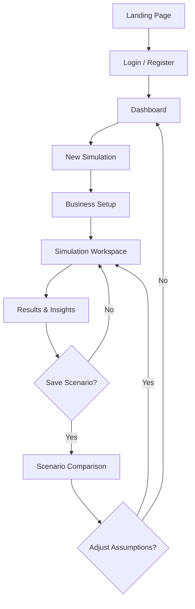

# STEP 2 — User Persona & User Flow

## 1. User Persona

### Persona Utama: Pemilik Bisnis

**Nama ilustratif:** Andi Pratama  
**Peran:** Pemilik usaha kecil  
**Karakteristik:** Mengelola aktivitas usaha sehari-hari dan perlu mempertimbangkan harga, biaya, serta volume transaksi. Tidak selalu memiliki latar belakang keuangan atau waktu untuk membuat spreadsheet simulasi sendiri.

**Kebutuhan:**
- Mengetahui perkiraan pendapatan dan keuntungan.
- Memahami dampak perubahan harga dan biaya.
- Membandingkan beberapa kemungkinan kondisi bisnis.
- Mendapatkan hasil yang mudah dibaca dan dipahami.

**Masalah:**
- Perhitungan dampak perubahan bisnis masih dilakukan secara manual.
- Sulit membandingkan beberapa skenario secara konsisten.
- Hubungan antara pendapatan, biaya, volume, dan laba tidak selalu terlihat jelas.

**Tujuan:**
Menggunakan simulasi sederhana untuk memahami konsekuensi dari beberapa asumsi bisnis sebelum menentukan langkah berikutnya.

## 2. Jobs to Be Done

Ketika mempertimbangkan perubahan harga, biaya, atau target transaksi, pengguna ingin mencoba beberapa asumsi dan membandingkan dampaknya agar dapat membuat keputusan dengan pemahaman yang lebih baik.

## 3. User Flow Utama

1. Pengguna membuka Landing Page Scenova.
2. Pengguna memilih untuk memulai dan masuk atau membuat akun.
3. Pengguna tiba di Dashboard.
4. Pengguna memilih `New Simulation`.
5. Pengguna mengisi nama simulasi, periode, nilai rata-rata transaksi, biaya variabel, biaya tetap, dan volume.
6. Sistem memvalidasi input dan menampilkan kondisi dasar.
7. Pengguna masuk ke Simulation Workspace.
8. Pengguna mengubah satu atau beberapa asumsi.
9. Sistem menghitung ulang metrik dan grafik.
10. Pengguna menyimpan skenario dengan nama yang mudah dikenali.
11. Pengguna membuat skenario lain atau menduplikasi skenario awal.
12. Pengguna memilih skenario untuk dibandingkan.
13. Sistem menampilkan tabel dan grafik perbandingan.
14. Pengguna dapat kembali mengubah asumsi atau membuka simulasi tersimpan.

## 4. Daftar Halaman

| Halaman | Tujuan | Aksi utama |
|---|---|---|
| Landing Page | Memperkenalkan manfaat Scenova | Start Simulation |
| Login / Register | Mengelola akses akun | Masuk / daftar |
| Dashboard | Menampilkan simulasi pengguna | New Simulation / Open |
| Business Setup | Mengisi data dasar | Save & Continue |
| Simulation Workspace | Mengubah asumsi | Adjust Inputs |
| Results & Insights | Menampilkan hasil | Save Scenario |
| Scenario Comparison | Membandingkan skenario | Select Scenarios |

## 5. Alur Navigasi

## 6. Kondisi dan Validasi Penting

- Semua nilai uang dan volume harus bernilai numerik dan tidak negatif.
- Nilai transaksi harus lebih besar dari atau sama dengan nol.
- Biaya variabel per transaksi tidak boleh negatif.
- Biaya tetap tidak boleh negatif.
- Volume transaksi harus bilangan bulat nol atau lebih.
- Jika pendapatan nol, operating margin ditampilkan sebagai `—`, bukan pembagian dengan nol.
- Jika contribution per transaction tidak positif, break-even ditandai tidak dapat dicapai dengan asumsi saat ini.
- Pengguna hanya boleh melihat dan mengubah simulasi miliknya sendiri.
- Jika penyimpanan gagal, tampilkan pesan yang jelas dan jangan menghapus input pengguna.
