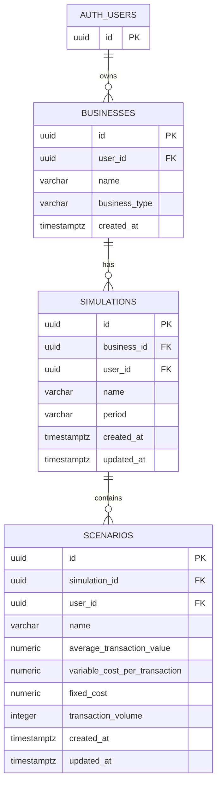

# STEP 4 — Database Schema

**Database:** PostgreSQL  
**Provider target:** Supabase  
**Authentication:** Supabase Auth

Schema ini dirancang untuk kebutuhan MVP: akun pengguna, simulasi bisnis, dan skenario yang dapat disimpan serta dibandingkan.

## 1. Relasi Entitas

## 2. Tabel `businesses`

Menyimpan profil bisnis yang dimiliki pengguna.

| Kolom | Tipe | Aturan | Keterangan |
|---|---|---|---|
| id | UUID | PK | ID bisnis |
| user_id | UUID | FK → auth.users.id, NOT NULL | Pemilik bisnis |
| name | VARCHAR(120) | NOT NULL | Nama bisnis |
| business_type | VARCHAR(30) | NOT NULL, default `other` | product, service, other |
| created_at | TIMESTAMPTZ | NOT NULL | Waktu dibuat |
| updated_at | TIMESTAMPTZ | NOT NULL | Waktu diperbarui |

## 3. Tabel `simulations`

Menyimpan proyek simulasi yang terkait dengan sebuah bisnis.

| Kolom | Tipe | Aturan | Keterangan |
|---|---|---|---|
| id | UUID | PK | ID simulasi |
| business_id | UUID | FK → businesses.id, NOT NULL | Bisnis terkait |
| user_id | UUID | FK → auth.users.id, NOT NULL | Pemilik data |
| name | VARCHAR(120) | NOT NULL | Nama simulasi |
| period | VARCHAR(20) | NOT NULL, default `monthly` | monthly, weekly, yearly |
| created_at | TIMESTAMPTZ | NOT NULL | Waktu dibuat |
| updated_at | TIMESTAMPTZ | NOT NULL | Waktu diperbarui |

## 4. Tabel `scenarios`

Menyimpan input asumsi untuk setiap skenario. Hasil perhitungan utama dihitung dari nilai input agar konsisten dengan fungsi perhitungan aplikasi.

| Kolom | Tipe | Aturan | Keterangan |
|---|---|---|---|
| id | UUID | PK | ID skenario |
| simulation_id | UUID | FK → simulations.id, NOT NULL | Simulasi induk |
| user_id | UUID | FK → auth.users.id, NOT NULL | Pemilik data |
| name | VARCHAR(80) | NOT NULL | Baseline, Optimistic, dll. |
| average_transaction_value | NUMERIC(14,2) | NOT NULL, CHECK >= 0 | Nilai rata-rata transaksi |
| variable_cost_per_transaction | NUMERIC(14,2) | NOT NULL, CHECK >= 0 | Biaya variabel per transaksi |
| fixed_cost | NUMERIC(14,2) | NOT NULL, CHECK >= 0 | Biaya tetap per periode |
| transaction_volume | INTEGER | NOT NULL, CHECK >= 0 | Jumlah transaksi |
| created_at | TIMESTAMPTZ | NOT NULL | Waktu dibuat |
| updated_at | TIMESTAMPTZ | NOT NULL | Waktu diperbarui |

## 5. Relasi dan Aturan Data

- Satu user dapat memiliki banyak bisnis.
- Satu bisnis dapat memiliki banyak simulasi.
- Satu simulasi dapat memiliki banyak skenario.
- Setiap record menyimpan `user_id` untuk memudahkan kebijakan akses.
- Penghapusan bisnis dapat menghapus simulasi dan skenario turunannya melalui `ON DELETE CASCADE`, setelah konfirmasi pengguna.
- Nama skenario harus unik dalam satu simulasi (unique constraint pada `simulation_id, name`) agar mudah dikenali.

## 6. Keamanan dan Row Level Security (RLS)

Aktifkan RLS pada seluruh tabel aplikasi.

Kebijakan minimum:
- Pengguna hanya dapat `SELECT`, `INSERT`, `UPDATE`, dan `DELETE` record dengan `user_id = auth.uid()`.
- Pada insert, `user_id` harus diisi dari sesi terautentikasi, bukan dipercaya dari input bebas klien.
- Relasi `business_id` dan `simulation_id` harus diverifikasi agar record tidak dapat ditautkan ke data milik pengguna lain.
- Jangan pernah mengekspos service-role key ke browser.

## 7. Catatan Implementasi

- Gunakan UUID sebagai primary key.
- Gunakan `NUMERIC`, bukan floating point, untuk nilai uang di database.
- Format mata uang dilakukan di sisi aplikasi; mata uang default MVP dapat menggunakan IDR, dengan kode mata uang disimpan atau ditetapkan konsisten pada level simulasi jika multi-currency disiapkan.
- Perhitungan hasil dilakukan melalui fungsi TypeScript murni dan diuji unit.
- Jangan menyimpan nilai hasil turunan jika tidak diperlukan. Jika kelak hasil historis harus dibekukan, tambahkan snapshot hasil dengan versi rumus yang eksplisit.
